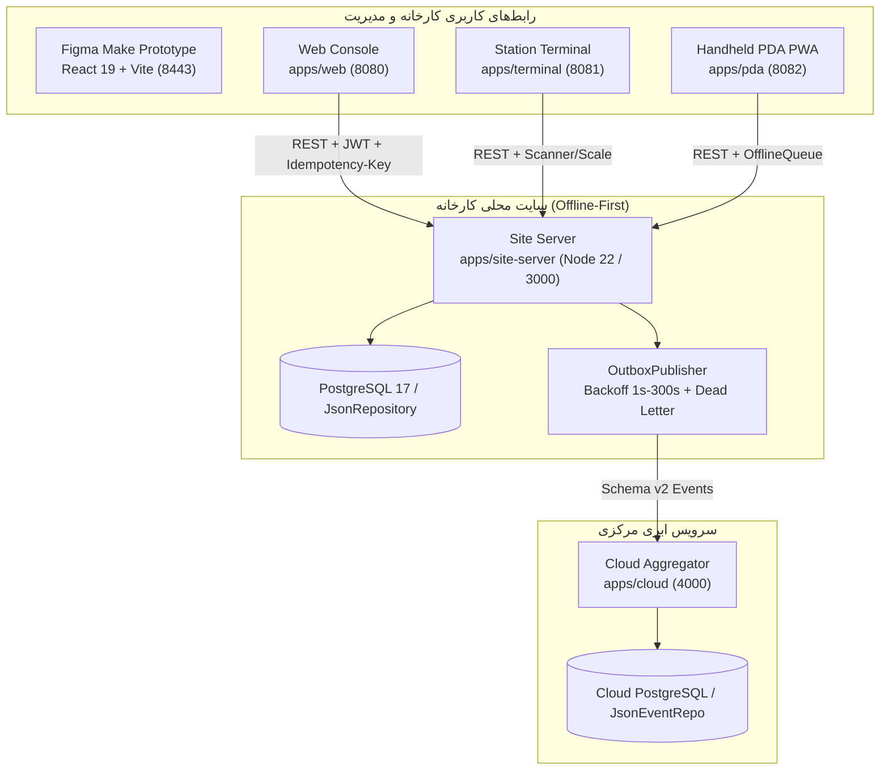

# معماری فنی و ساختار Monorepo پروژه StoreMesh

## ۱. نمای کلی معماری چندسایتی (Multi-Site Offline-First)

سامانه **StoreMesh** برای کارخانه‌های فرآوری و سردخانه‌ای (سایت‌های **ایران**، **دبی** و **رم**) طراحی شده است. اصل کلیدی معماری این است که **هر سایت کارخانه مستقل از اینترنت کار می‌کند** و تمام رویدادهای عملیاتی پس از ثبت قطعی محلی، از طریق الگوی **Transactional Outbox** به سرویس ابری مرکزی (`apps/cloud`) ارسال می‌شوند.

---

## ۲. ساختار پوشه‌های Monorepo (`storemesh-platform`)

| مسیر | نقش فنی | تکنولوژی / وضعیت |
|---|---|---|
| `apps/site-server/` | هسته قوانین دامین، احراز هویت، Audit، Outbox و Repositoryها | Node.js ESM (`>=20`) + `pg` + ۸۰ فایل Migration |
| `apps/cloud/` | تجمیع رویدادهای چندسایتی، وضعیت سلامت سایت‌ها و خروجی CSV/NDJSON | Node.js ESM + `pg` / `JsonEventRepository` |
| `apps/web/` | پنل وب مدیریت موجودی، QC، اقلام مصرفی، چاپ و تنظیمات | Vanilla JS ES Modules + `qrcode-generator` |
| `apps/terminal/` | رابط لمسی ایستگاه‌های خط تولید + درایور TCP ترازو/پرینتر | Vanilla JS + ماژول‌های `src/` |
| `apps/pda/` | اپلیکیشن PWA اسکنر همراه با `OfflineQueue` و `service-worker.js` | Vanilla JS PWA (بدون APK) |
| `apps/figma-make-ui/` | پروتوتایپ کامل ۱۳ ایستگاه با شبیه‌ساز اسکنر/ترازو/چاپگر | React 19 + Tailwind v4 + Vite 8 (فعلاً `localStorage`) |
| `packages/contracts/` | قراردادهای OpenAPI 3.1 (`storemesh.yaml` و `storemesh-cloud.yaml`) + Parity | ۸۰ تست + بررسی تطابق ۱۶۲ مسیر Site و ۸ مسیر Cloud |
| `infrastructure/` | Docker Compose (۳ سایت + Cloud + Prometheus + Backup) | نیازمند اصلاح مسیرها از `../storemesh-*` به `../apps/*` |
| `e2e/` | تست‌های HTTP سرتاسری چندسایتی و سلامت سرویس‌ها | Node test runner |
| `docs/` | مستندات معماری، ممیزی، استقرار، قواعد دامین و Fix Requestها | `done/`, `open/`, `needs-decision/` |
| `scripts/` + `launcher.mjs` | لانچر بومی بدون نیاز به داکر و اسکریپت‌های Seed و Health Check | Node.js + Bash |

---

## ۳. لایه‌های ذخیره‌سازی و همگام‌سازی

1. **PostgreSQL 17 (`PostgresRepository`):**
   - قفل خوش‌بینانه در سطح سایت از طریق جدول `site_state_versions` (`SELECT ... FOR UPDATE`).
   - تریگر `enforce_append_only_history()` در Migration شماره `068` برای جلوگیری از `UPDATE` و `DELETE` روی `audit_events` و `event_history_archive`.
   - آرشیو خودکار رویدادهای قدیمی‌تر از ۳۰ روز (`outbox`) و ۳۶۵ روز (`audit`) در `event_history_archive`.
2. **حالت محلی بدون دیتابیس (`JsonRepository`):**
   - مناسب توسعه و تست سریع با متغیر محیطی `DATA_FILE` (ذخیره اتمیک از طریق فایل موقت + `renameSync`).
3. **الگوی `OutboxPublisher`:**
   - ارسال دسته‌های تا ۱۰۰ رویداد با Backoff نمایی (`1s` تا `300s` + ±۲۰٪ jitter).
   - پس از ۵ خطا رویداد به `DEAD_LETTER` می‌رود و با اندپوینت بازیابی قابل ارسال مجدد است.
